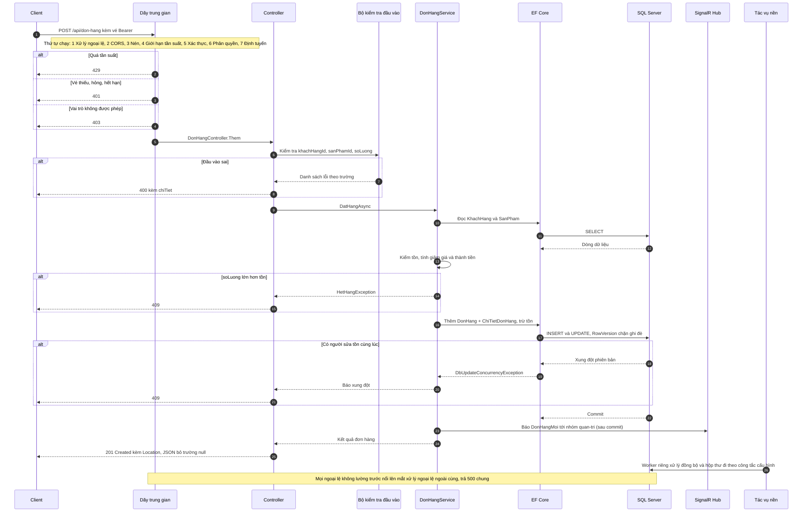

# Luồng đặt hàng: `POST /api/don-hang` (API023)

Tài liệu này mô tả đường đi của một lời gọi đặt hàng từ client tới SQL Server và ngược lại, những chỗ lời gọi có thể thất bại, và các nhánh chạy song song. Đơn hàng v1 có một dòng chi tiết; cột sản phẩm/số lượng cũ vẫn được giữ để tương thích API. Webhook thanh toán tạo sự kiện hộp thư đi riêng.

**Lời gọi mẫu**

```
POST /api/don-hang
Authorization: Bearer <vé JWT>
Content-Type: application/json

{ "khachHangId": 1, "sanPhamId": 3, "soLuong": 10 }
```

## 1. Sơ đồ



## 2. Tình huống lỗi

| Tình huống                                                          | Mã  | Xảy ra ở bước                      | Ghi chú                                                                                                            |
| ------------------------------------------------------------------- | --- | ---------------------------------- | ------------------------------------------------------------------------------------------------------------------ |
| Gọi quá dày (endpoint có gắn chính sách giới hạn)                    | 429 | Giới hạn tần suất (mắt 4)          | Đăng nhập và webhook có giới hạn; endpoint đặt hàng chưa gắn chính sách riêng.                                     |
| Thiếu vé, vé hỏng, hết hạn, sai nơi phát hành                       | 401 | Xác thực (mắt 5)                   | Chưa biết người gọi là ai.                                                                                         |
| Đã biết người gọi nhưng vai trò không được phép                     | 403 | Phân quyền (mắt 6)                 | API quản trị kiểm tra policy/role; khách hàng chỉ đọc hoặc hủy đơn do chính mình tạo.                             |
| Thân thiếu trường, `soLuong` ≤ 0, khách hoặc sản phẩm không tồn tại | 400 | Controller và bộ kiểm tra          | Phải tự kiểm tra, vì bộ lọc tự động của `[ApiController]` có thể bị tắt (§5.4).                                    |
| `soLuong` lớn hơn tồn, hoặc hai request cùng tranh món cuối         | 409 | `DonHangService`                   | Hết hàng ném ngoại lệ nghiệp vụ; tranh chấp bị `RowVersion` phát hiện. Controller đổi cả hai thành 409.            |
| Lỗi không lường trước (CSDL sập, lỗi lập trình)                     | 500 | Xử lý ngoại lệ (mắt 1, ngoài cùng) | Vết ngăn xếp chỉ vào nhật ký; phản hồi chỉ ghi "Lỗi hệ thống".                                                     |

## 3. Hai nhánh chạy song song

- **Tác vụ nền** gắn vào **CSDL**, không gắn vào lời gọi. Worker đồng bộ gọi dịch vụ ngoài theo chu kỳ một phút; worker hộp thư đi gửi sự kiện webhook thanh toán và thử lại với backoff. Mỗi vòng mở một phạm vi dịch vụ riêng để lấy `DbContext`. Cả hai công tắc cấu hình mặc định tắt.
- **SignalR** gắn vào **`DonHangService`, ngay sau commit**. Báo trước khi commit thì nếu giao dịch bị hủy, quản trị đã thấy một đơn không tồn tại. Thông điệp chỉ mang `id`; màn hình nhận được thì tự gọi API lấy chi tiết. Thông báo chỉ là bổ sung, tải lại trang vẫn phải ra đúng dữ liệu.
- **Hộp thư đi** được ghi cùng trạng thái thanh toán và khóa idempotency webhook trong một giao dịch. Worker gửi sau commit; endpoint của bên nhận cần xử lý `Idempotency-Key` để chống xử lý lặp.

## 4. Ba lựa chọn công nghệ

**Newtonsoft.Json thay cho bộ mặc định.** System.Text.Json có sẵn và nhanh hơn, nhưng nghiêm ngặt và ít chỗ tùy chỉnh. Newtonsoft chậm hơn đôi chút nhưng khoan dung với dữ liệu lệch chuẩn và cho tùy chỉnh sâu: bỏ trường null, bỏ qua vòng tham chiếu, cố định định dạng ngày giờ. Với một API mà JSON chính là hợp đồng với phía gọi, những tùy chỉnh đó đáng giá hơn chênh lệch tốc độ. Cái giá là thêm một gói phụ thuộc.

**EF Core nhưng vẫn viết SQL thô ở chỗ nặng.** EF Core viết nhanh và an toàn cho phần lớn truy vấn như đặt hàng và CRUD. Truy vấn tổng hợp phức tạp, ví dụ doanh số theo sản phẩm theo tháng, thì SQL viết tay gọn và nhanh hơn. Kịch bản triển khai và việc đọc kế hoạch thực thi cũng phải làm bằng SQL. Hai cách cùng tồn tại là bình thường, miễn SQL thô luôn truyền tham số.

**JWT thay cho phiên lưu trên máy chủ.** Vé tự mang thông tin, máy chủ chỉ cần kiểm chữ ký và hạn dùng nên không phải giữ trạng thái. Nhờ vậy hệ thống chạy được nhiều máy chủ song song và phục vụ được ứng dụng di động. Cái giá: vé đã phát ra thì dùng được đến lúc hết hạn, kể cả khi tài khoản vừa bị khóa, nên phải đặt hạn ngắn. Phần giữa của vé chỉ mã hóa Base64, ai cầm vé cũng đọc được, nên không đặt thông tin nhạy cảm vào đó.
